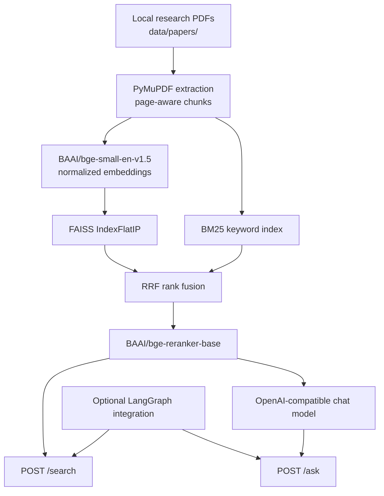

# ThermoWaste-RAG
[English](README.md) | [简体中文](README_CN.md)

**Evidence-aware literature retrieval and question answering for waste thermochemical conversion**

  

ThermoWaste-RAG is a Python research prototype for answering questions about waste gasification and related thermochemical processes **using retrieved paper excerpts**. It combines semantic and lexical search, rank fusion, cross-encoder reranking, an OpenAI-compatible LLM API, and a small FastAPI service with source/page references.

The repository also contains an **experimental LangGraph tool-calling integration**. That integration reuses the RAG service through HTTP; it is not a separate, production-ready research agent. A fuller stand-alone Agent project is planned independently.

> **Scope and trust:** This is a demonstrated research prototype, **not** a production service or a scientifically validated expert system. A returned citation means a source was retrieved, not necessarily that it supports every generated claim. Research claims must be checked against the original papers.

## Highlights

- **Hybrid retrieval:** BGE sentence embeddings + FAISS dense search, BM25 keyword search, and Reciprocal Rank Fusion (RRF).
- **Two-stage ranking:** `BAAI/bge-reranker-base` reranks retrieved candidates before question answering.
- **Evidence-aware answers:** The LLM receives retrieved excerpts with paper names and **1-based PDF page numbers**; responses include source metadata.
- **FastAPI endpoints:** `GET /health`, `POST /search`, and `POST /ask`, with input validation, basic error handling, and per-stage timing.
- **Retrieval evaluation:** A source/page-labeled question file and Hit@5/MRR@5 comparisons across Dense, BM25, Hybrid, and Hybrid + Reranker.
- **Optional Agent integration:** LangGraph tool calling using `/search` and `/ask`, plus preliminary citation provenance and claim-review utilities.

## Architecture



Full design and limitations: [Architecture](docs/ARCHITECTURE.md).

## Technology stack

| Layer | Implementation |
| --- | --- |
| PDF text extraction | PyMuPDF (`fitz`) |
| Chunking | LangChain `RecursiveCharacterTextSplitter` (800 characters; 150 overlap) |
| Dense embeddings | `BAAI/bge-small-en-v1.5` via Sentence Transformers |
| Vector search | FAISS `IndexFlatIP` over normalized vectors |
| Sparse retrieval | `rank-bm25` / `BM25Okapi` (basic whitespace tokenization) |
| Rank fusion | RRF (`rrf_k=60`) |
| Reranking | `BAAI/bge-reranker-base` cross-encoder |
| Generation | Configurable OpenAI-compatible chat-completions endpoint |
| HTTP API | FastAPI + Uvicorn + Pydantic |
| Optional tool calling | LangGraph + LangChain OpenAI client (separate Python environment) |

## Quick start

### 1. Prepare the RAG environment

This project was exercised in an existing Windows/Conda RAG environment. **Keep a working environment rather than upgrading all ML dependencies blindly.** A fresh environment may require compatible versions of PyTorch, Sentence Transformers and FAISS for your platform.

```powershell
# From the repository root
conda activate transformers
python -m pip install -r requirements.txt
Copy-Item .env.example .env
```

Edit **only your local** `.env` file and configure:

```ini
OPENAI_API_KEY=YOUR_API_KEY
OPENAI_BASE_URL=https://your-provider.example/v1
OPENAI_MODEL=your-chat-model
```

The configured provider must expose a compatible chat-completions API. Never commit a real `.env` file or API key.

### 2. Provide your local papers

Create `data/papers/` and add PDF files you are authorized to use. The repository **does not distribute the research PDFs**. If running the included evaluation, your local filenames and PDF page numbering must match the source/page annotations in `data/eval_questions.json` (e.g., `paper07.pdf`). Evaluation numbers are not independently reproducible without the original local corpus.

### 3. Start the API

```powershell
python -m uvicorn api:app --reload
```

Open <http://127.0.0.1:8000/docs> for interactive Swagger documentation. The first startup extracts local PDFs, computes embeddings, builds in-memory indexes, and loads the reranker; it can take time.

Try a meaningful research question rather than the Swagger placeholder `"string"`:

```powershell
$body = @{ query = 'How does gasification temperature affect hydrogen production?'; top_k = 5 } | ConvertTo-Json
Invoke-RestMethod -Uri 'http://127.0.0.1:8000/ask' -Method Post -ContentType 'application/json' -Body $body
```

Or run a one-question terminal demo with `python app.py`.

API schemas, validation limits, and error codes: [API guide](docs/API_GUIDE.md).

## Evaluation and tests

The checked-in `data/eval_questions.json` currently contains **15 question records** marked `source_page_evidence_verified`. Labels identify supporting PDF **pages**, not verified passages or fully audited scientific claims; coverage may be incomplete. The file can be used for Hit@5 and MRR@5 testing **only with the matching local papers**.

```powershell
# Lightweight module tests (no PDFs/LLM API required)
python -m tests.test_citation_audit
python -m tests.test_claim_evidence_review
python -m tests.test_evaluation
python -m tests.test_quality_gate

# Starts the local evaluation run; requires the original PDF corpus/models
python -m src.evaluation

# After starting FastAPI: request/validation smoke test; no /ask LLM call
python -m scripts.smoke_test_api
```

The Agent simulation test, `python -m tests.test_research_agent`, requires the optional Agent environment below, but not a live LLM call.

See [Evaluation and observed results](docs/EVALUATION.md) for metrics, known limitations, and the distinction between exploratory logs and a reproducible benchmark.

## Optional LangGraph integration

A tool-calling experiment is included in `research_agent.py` as a **consumer of this RAG service**. It supports `search_papers`, `ask_rag`, source-page provenance checks, and preliminary claim-review reporting. It does **not** yet implement a complete planner/memory/research-report workflow.

Keep FastAPI running in the first terminal; in a **separate** Python 3.11 environment:

```powershell
conda create -n thermowaste-agent python=3.11 -y
conda activate thermowaste-agent
python -m pip install -r requirements-agent.txt
Copy-Item .env.agent.example .env.agent
# Fill in AGENT_API_KEY, AGENT_BASE_URL, AGENT_MODEL and RAG_API_URL locally
python research_agent.py --audit --question 'Compare temperature and steam/fuel ratio effects on hydrogen production.'
```

`AGENT_MODEL` must support tool/function calling on the chosen provider. See [Architecture](docs/ARCHITECTURE.md) for the integration boundary. `--review-claims --judge` additionally invokes an LLM and its judgments **must not** be treated as ground truth.

## Repository map

```text
api.py                     FastAPI application (RAG service)
app.py                     Single-question RAG demo
research_agent.py          Optional LangGraph integration / CLI
src/                       PDF loading, indexing, retrieval, generation, evaluation
agent/                     Preliminary citation and claim-review utilities
tests/                     Offline unit/simulation tests
scripts/                   Smoke test and local helper utilities
data/eval_questions.json   Annotated evaluation questions (PDFs not included)
docs/                      Architecture, evaluation, API documentation
```

## Known limitations and responsible use

- The corpus and question set are small and domain-specific. The evaluation does not establish generalization to unseen studies or other scientific fields.
- BM25 uses `.lower().split()`; it does not perform domain-specific tokenization, stemming, or unit normalization.
- Page-level source matches and provisional LLM `SUPPORTED` labels **do not establish factual support**. Forward water-gas shift (WGS) is exothermic; model outputs have previously mischaracterized its thermochemistry. H₂ **concentration** and H₂ **yield** must also be distinguished.
- PDF tables can be flattened by text extraction; numerical claims require original-paper inspection.
- Indexes are rebuilt at API startup; there is no persisted FAISS index, streaming generation, authentication, hosted deployment, or production load test.
- API inference is serialized through locks on a local pipeline; latency measurements are limited observations, not SLA guarantees.
- Raw papers, secrets, model weights, and local reports are intentionally excluded from source release. **`.gitignore` does not remove files from an older Git history**; publish from a checked, clean history if needed.

## Documentation

- [System architecture](docs/ARCHITECTURE.md)
- [Retrieval evaluation and limitations](docs/EVALUATION.md)
- [API request and response guide](docs/API_GUIDE.md)

## Project status

The core RAG API and the experimental tool-calling integration have been exercised locally. This repository represents a **research and job-portfolio prototype**. Independent ground-truth claim verification and a stand-alone planner-based ResearchAgent remain future work.
