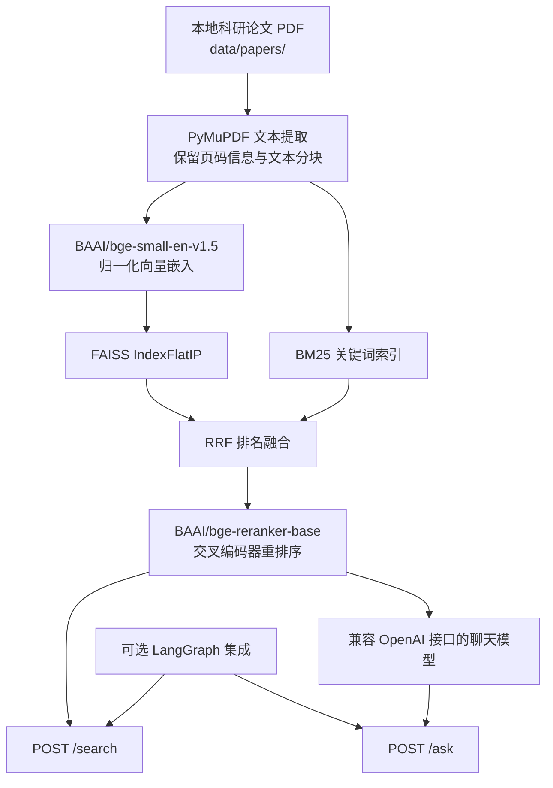

# ThermoWaste-RAG

**面向固体废弃物热化学转化研究的可溯源文献检索与智能问答系统**

  

[English README](README.md) · **简体中文**

ThermoWaste-RAG 是一个基于 Python 的科研原型系统，面向固废气化及相关热化学转化领域，利用**从科研论文中检索到的原文片段**回答专业问题。系统结合语义检索、关键词检索、排序融合、交叉编码器重排序，以及兼容 OpenAI 接口格式的大语言模型，并通过 FastAPI 提供带有文献名称和页码信息的检索与问答服务。

仓库还提供了一个**实验性的 LangGraph 工具调用集成示例**。该示例通过 HTTP 复用 RAG 服务，并不等同于一个独立、生产就绪的科研智能体。更完整的独立 ResearchAgent 将作为后续项目开发。

> **项目定位与可信度说明：** 本项目已完成本地功能验证，但仍属于**科研与求职展示原型**，不是生产级服务，也不是经过严格科学验证的专家系统。回答中出现某篇论文的引用，仅说明系统检索到了相应来源，**不代表该来源能够支持回答中的每一项结论**。重要科研判断仍需回到原始论文核实。

## 1. 核心功能

- **混合检索（Hybrid Retrieval）：** 使用 BGE 向量嵌入和 FAISS 进行稠密检索，以 BM25 进行关键词检索，并通过倒数排名融合（Reciprocal Rank Fusion，RRF）合并结果。
- **两阶段排序：** 使用 `BAAI/bge-reranker-base` 对候选片段进行重排序，提高最终送入大模型的证据相关性。
- **带来源信息的问答：** 大语言模型接收包含论文文件名及 **从 1 开始计数的 PDF 页码**的检索片段；接口同时返回文献来源元数据。
- **FastAPI 接口：** 提供 `GET /health`、`POST /search` 和 `POST /ask`，支持输入校验、基础异常处理及分阶段耗时统计。
- **检索效果评估：** 使用标注文献来源及页码的问题集，通过 Hit@5 和 MRR@5 比较 Dense、BM25、Hybrid、Hybrid + Reranker 等检索方案。
- **可选 Agent 集成：** 基于 LangGraph 调用 `/search`、`/ask`，并提供初步的引用来源检查和科学主张核验辅助工具。

## 2. 系统架构



更详细的系统设计与限制见：[系统架构文档（英文）](docs/ARCHITECTURE.md)。

## 3. 技术栈

| 模块 | 技术与实现方式 |
| --- | --- |
| PDF 文本提取 | PyMuPDF（`fitz`） |
| 文本分块 | LangChain `RecursiveCharacterTextSplitter`，块大小 800 字符，重叠 150 字符 |
| 稠密向量嵌入 | `BAAI/bge-small-en-v1.5`，通过 Sentence Transformers 加载 |
| 向量检索 | FAISS `IndexFlatIP`，使用归一化向量 |
| 稀疏检索 | `rank-bm25` / `BM25Okapi`，采用基础空白符分词 |
| 排名融合 | RRF，`rrf_k=60` |
| 重排序 | `BAAI/bge-reranker-base` 交叉编码器 |
| 答案生成 | 可配置、兼容 OpenAI Chat Completions 格式的模型接口 |
| HTTP API | FastAPI、Uvicorn、Pydantic |
| 可选工具调用 | LangGraph、LangChain OpenAI 客户端，使用独立 Python 环境 |

## 4. 快速开始

### 4.1 准备 RAG 运行环境

项目已在现有 Windows / Conda 环境中进行本地测试。**建议优先保留已经能够运行的环境，不要盲目升级所有机器学习依赖。** 如需新建环境，应注意 PyTorch、Sentence Transformers、FAISS 与当前系统的版本兼容性。

```powershell
# 在仓库根目录执行（PowerShell）
conda activate transformers
python -m pip install -r requirements.txt
Copy-Item .env.example .env
```

如果使用的是 CMD 或 Anaconda Prompt，可将最后一条替换为 `copy .env.example .env`。

仅在**本地**编辑 `.env`，配置模型服务：

```ini
OPENAI_API_KEY=YOUR_API_KEY
OPENAI_BASE_URL=https://your-provider.example/v1
OPENAI_MODEL=your-chat-model
```

模型服务需要提供兼容 Chat Completions 的接口。**不要把真实 `.env` 文件或 API Key 提交到 GitHub。**

### 4.2 准备本地论文

在项目根目录创建 `data/papers/`，放入你拥有合法使用权限的 PDF 论文。

**本仓库不分发论文 PDF 全文。** 如果需要运行随项目提供的评测问题集，必须确保本地 PDF 文件名及页码与 `data/eval_questions.json` 中的来源标注对应（例如 `paper07.pdf`）。缺少原始论文语料时，无法独立复现已有的检索实验。

### 4.3 启动 FastAPI

```powershell
python -m uvicorn api:app --reload
```

浏览器访问：<http://127.0.0.1:8000/docs>，可在 Swagger 页面中测试接口。

首次启动时，程序需要读取本地 PDF、生成嵌入向量、构建内存索引并加载重排序模型，因此启动时间可能较长。

请使用真实科研问题，不要直接提交 Swagger 默认的 `"string"` 占位文本：

```powershell
$body = @{ query = 'How does gasification temperature affect hydrogen production?'; top_k = 5 } | ConvertTo-Json
Invoke-RestMethod -Uri 'http://127.0.0.1:8000/ask' -Method Post -ContentType 'application/json' -Body $body
```

也可以运行 `python app.py`，在终端完成一次独立问答演示。

请求格式、参数校验及错误码详见：[API 使用指南（英文）](docs/API_GUIDE.md)。

## 5. 检索评测与测试

仓库中的 `data/eval_questions.json` 目前包含 **15 条标记为 `source_page_evidence_verified` 的问题记录**。这些标签表示已标注文献的**支持页码**，不等于每条原文证据或生成的科学主张都已完成独立人工审查；答案支持证据也可能尚不完整。

该问题集可用于计算 Hit@5、MRR@5，但前提是使用与标注对应的本地论文语料。

```powershell
# 轻量级模块测试：不需要论文 PDF 或在线大模型 API
python -m tests.test_citation_audit
python -m tests.test_claim_evidence_review
python -m tests.test_evaluation
python -m tests.test_quality_gate

# 检索评测：需要匹配的原始 PDF 及相关模型
python -m src.evaluation

# 启动 FastAPI 后运行接口冒烟测试；不调用 /ask 大模型生成
python -m scripts.smoke_test_api
```

Agent 模拟测试 `python -m tests.test_research_agent` 需要下文介绍的可选 Agent 环境，但无需调用在线大模型。

相关评价指标、已观察到的结果以及“探索性测试日志”与“可复现实验”的区别，参见：[检索评测文档（英文）](docs/EVALUATION.md)。

**评测解释注意事项：** 小规模问题集上的结果不能证明模型在未见过的论文或其他科研领域具备可靠泛化能力；Hybrid + Reranker 也不保证在所有指标和问题上始终优于 Hybrid。

## 6. 可选 LangGraph 集成

`research_agent.py` 提供一个**调用 RAG HTTP 服务的 LangGraph 工具调用实验**，支持 `search_papers`、`ask_rag`、来源页码溯源检查以及初步的科学主张核验报告。

它目前**尚未实现完整的独立 Planner、长期 Memory 和自动科研报告工作流**。独立 ResearchAgent 将作为另一项工程继续开发。

保持第一个终端中的 FastAPI 正常运行，再在**另一个 Python 3.11 环境**中执行：

```powershell
conda create -n thermowaste-agent python=3.11 -y
conda activate thermowaste-agent
python -m pip install -r requirements-agent.txt
Copy-Item .env.agent.example .env.agent
# 在本地填写 AGENT_API_KEY、AGENT_BASE_URL、AGENT_MODEL、RAG_API_URL
python research_agent.py --audit --question 'Compare temperature and steam/fuel ratio effects on hydrogen production.'
```

如果使用 CMD / Anaconda Prompt，复制环境变量模板时使用 `copy .env.agent.example .env.agent`。

选用的 `AGENT_MODEL` 必须支持工具调用（Tool / Function Calling）。`--review-claims --judge` 会额外使用大模型判断证据支持情况，但这些自动判断**不能直接视为科学事实或人工核验结论**。

关于 RAG 与 Agent 的接口边界，请参见：[系统架构文档（英文）](docs/ARCHITECTURE.md)。

## 7. 项目目录

```text
api.py                     FastAPI 应用 / RAG 服务
app.py                     单问题 RAG 演示入口
research_agent.py          可选 LangGraph 集成与命令行入口
src/                       PDF 读取、索引、检索、生成与评测
agent/                     初步引用审计与科学主张核验工具
tests/                     离线单元测试及模拟测试
scripts/                   接口冒烟测试和本地辅助脚本
data/eval_questions.json   带有来源标注的评测问题（不附论文全文）
docs/                      系统架构、评测及 API 文档
```

## 8. 已知局限与负责任使用说明

- **语料与评测规模有限：** 当前语料库和问题集规模较小，且聚焦固废热化学转化领域；不能据此声称系统已经具备跨研究或跨领域泛化能力。
- **BM25 分词较为基础：** 当前实现使用 `.lower().split()`，尚未加入领域专用分词、词干提取或单位归一化。
- **引用核验不等于事实核验：** 文献页码命中，以及模型自动给出的 `SUPPORTED` 标记，都不能单独证明某项科学结论正确。例如，正向水煤气变换反应（WGS）是放热反应，先前模型输出曾误述其热效应；分析时也必须区分 H₂ **体积分数/浓度**与 H₂ **实际产率**。
- **PDF 表格抽取可能丢失结构：** 原始表格经文本提取后可能出现列顺序混乱，因此涉及具体数值的结论需要人工核查原文。
- **尚不具备生产级部署能力：** 服务启动时重新构建内存索引；当前没有持久化 FAISS 索引、流式生成、身份认证、线上托管部署或生产负载测试。
- **性能数据仅用于本地观察：** API 使用锁串行访问本地推理链路；已有耗时测试不构成服务等级承诺（SLA）。
- **公开仓库不提供敏感或受限内容：** 原始论文、密钥、模型权重与本地报告不纳入代码发布。需要注意，**`.gitignore` 不能自动移除旧 Git 历史中已经提交过的文件**；正式公开时应使用经过检查的干净历史。

## 9. 补充文档

- [系统架构（英文）](docs/ARCHITECTURE.md)
- [检索评测与局限性（英文）](docs/EVALUATION.md)
- [API 请求与响应指南（英文）](docs/API_GUIDE.md)

## 10. 项目状态

目前已在本地验证核心 RAG 接口和实验性的 LangGraph 工具调用集成。项目定位为**科研原型及求职作品**。

独立、具备人工真值支持的科学主张核验，以及拥有完整规划能力的独立 ResearchAgent，仍属于后续工作，不应视为本项目已经完成的功能。
