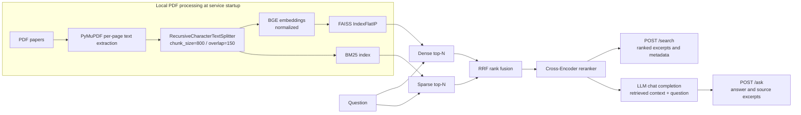
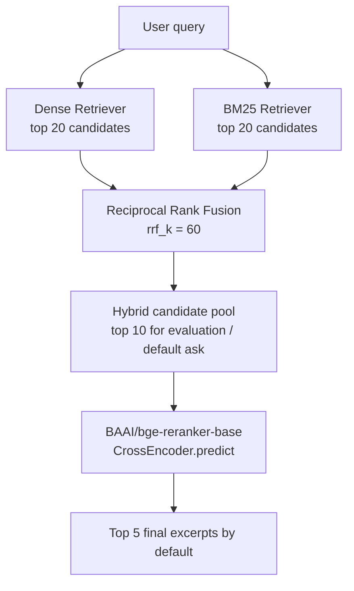
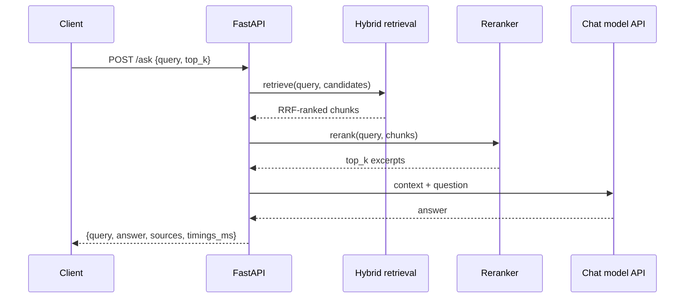
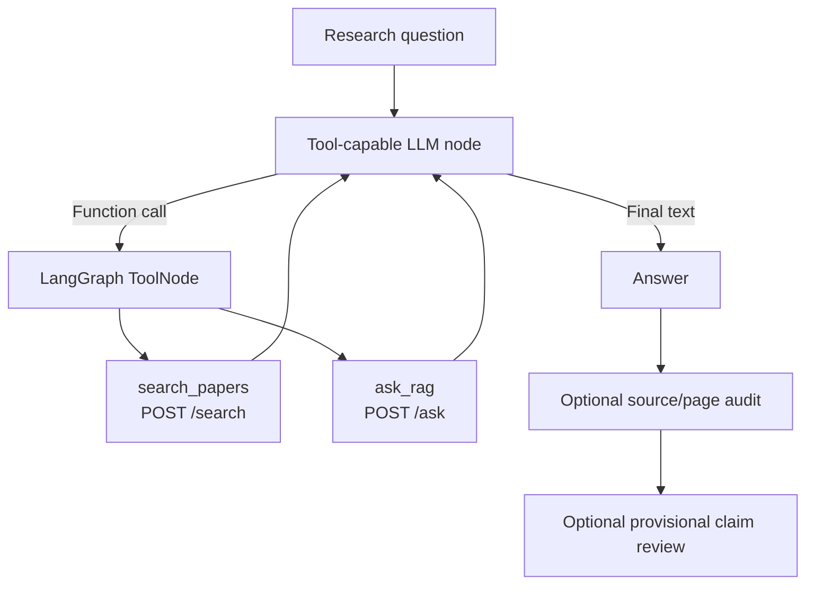

# System Architecture

[← Back to README](../README.md)

## 1. Scope and system boundary

ThermoWaste-RAG is a **local research prototype** for literature-grounded question answering about waste thermochemical conversion. Its primary responsibility is **retrieval, evidence ranking, and answer generation over a user-supplied PDF corpus**.

An optional LangGraph CLI, `research_agent.py`, consumes the RAG API through HTTP. It is an **integration experiment** within this repository; the envisioned independent planner-based ResearchAgent is not implemented here.

## 2. End-to-end flow

**Index construction is in-memory at each FastAPI worker's startup**, not a persisted vector database. The corpus is loaded from `data/papers/` and is not part of the public repository.

## 3. PDF processing and indexing

| Stage | Implementation | Important caveat |
| --- | --- | --- |
| Load | `src/loader.py` uses `fitz.open` / `page.get_text()` | Blank-text PDF pages are skipped; no OCR for scanned PDFs |
| Metadata | `source` = PDF filename; `page` = `page_num + 1` | Page numbers are physical PDF positions (1-based), not necessarily printed page labels |
| Chunk | `RecursiveCharacterTextSplitter(800, 150)` | Each chunk inherits its source page; layout-sensitive tables can lose structure |
| Embedding | `BAAI/bge-small-en-v1.5` | Both document and query vectors are normalized |
| Dense search | FAISS `IndexFlatIP` | Inner product over normalized vectors is cosine-equivalent |
| Sparse search | `BM25Okapi` over `.lower().split()` tokens | Punctuation, units, symbols, and morphology are not explicitly normalized |

Chunk metadata is preserved through dense and sparse retrieval, fusion, reranking, and API responses.

## 4. Ranking design

For an item ranked at position `rank` in one or more retrieval lists, the implementation accumulates the RRF contribution:

\[
\mathrm{RRF}(d) = \sum_{r \in \{\mathrm{Dense}, \mathrm{BM25}\}} \frac{1}{60 + \mathrm{rank}_{r}(d)}
\]

Only retrieval lists containing that item contribute to its score. Duplicates are identified by the `(source, page, text)` tuple. The cross-encoder then scores `(query, chunk_text)` pairs and sorts candidates by its model score. **Reranker score is a ranking value, not a calibrated probability of correctness.**

The API derives its candidate limits from the supplied `top_k` (`candidate_k = max(20, top_k × 4)` and `hybrid_top_k = max(10, top_k × 2)`), then returns up to `top_k` final excerpts. The evaluation script independently uses Hybrid top 10 and reranked top 5. See [EVALUATION.md](EVALUATION.md).

## 5. Generation and evidence handling

`src/llm.py` builds a prompt that enumerates retrieved passages as `Source [1]`, `Source [2]`, etc., with filename, PDF page, and excerpt. The prompt instructs the LLM to answer from the supplied context, avoid fabricated facts, distinguish hydrogen concentration from yield, and acknowledge insufficient evidence.

**The model can still make scientific mistakes.** In earlier testing, forward water-gas shift was described as endothermic even though it is exothermic. An improved prompt can help, but is not an independent proof of scientific correctness.

The `/ask` response includes both the free-text answer and the source snippets actually supplied to the LLM. The source number `[1]` in an answer refers to the **position in this particular `sources` list**, not a stable global paper ID.

## 6. API runtime

- `api.py` constructs the pipeline once per Uvicorn worker via a FastAPI lifespan startup hook.
- A local lock serializes retrieval/reranking inference on the shared pipeline; a separate lock guards LLM client calls.
- Pydantic validates request field types and `top_k` bounds; application logic rejects whitespace-only questions.
- Internal exceptions are logged server-side and the API returns generic 503 (retrieval) or 502 (LLM) errors.
- `timings_ms` reports measured retrieval, reranking, LLM (if used), and total request time; this is **not** a profiling or load-testing system.

See [API_GUIDE.md](API_GUIDE.md) for exact schemas and examples.

## 7. Optional LangGraph integration

The tool-calling CLI uses a separate Python 3.11 environment and communicates with RAG over `http://127.0.0.1:8000` by default. It caps tool-execution rounds (`MAX_TOOL_ROUNDS = 3`) and truncates text excerpts presented through its search tool. The integrated audits can:

1. Check whether a cited `(filename, PDF page)` appeared in the current run's retrieved tool results.
2. Extract citation-bearing lines and prepare evidence excerpts for **provisional** LLM-assisted review.
3. Flag some claims for manual review through conservative rules.

It **cannot** establish that a citation supports every scientific statement, and its current claim extraction does not reliably split complex text into atomic claims. It does not provide a durable memory store, independent planner, MCP integration, or automated scientific report generator.

## 8. Design limitations and extensions

**Known limitations:** small/local corpus, basic BM25 tokenization, flattened PDF tables, no persistent index, no comprehensive scientific ground-truth evaluation, and unbenchmarked multi-user concurrency. Private papers and API keys are not bundled.

**Potential extensions (not implemented):** index persistence, stronger input quality checks, streaming answers, structured claim extraction, manual labeled support/contradiction dataset, cross-document citation evaluation, authenticated service deployment, and an independent planner/memory-based ResearchAgent.
